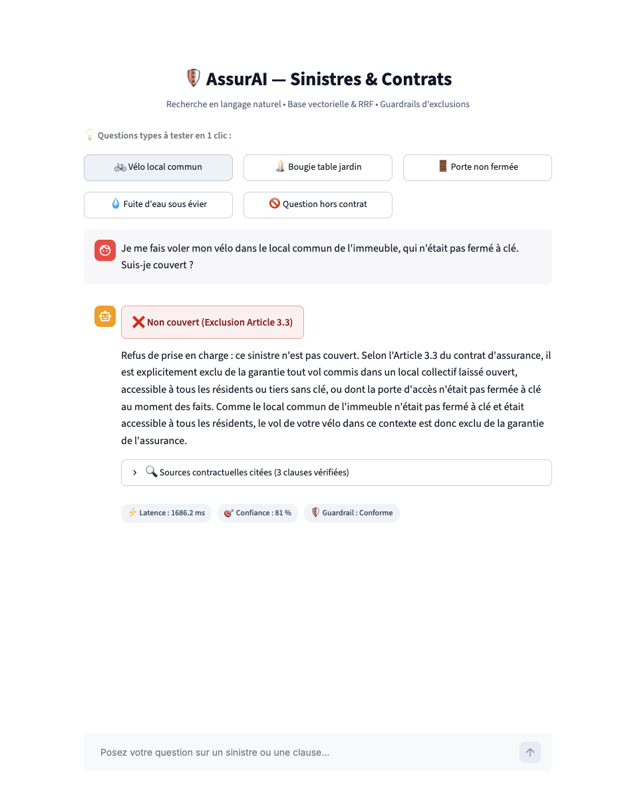
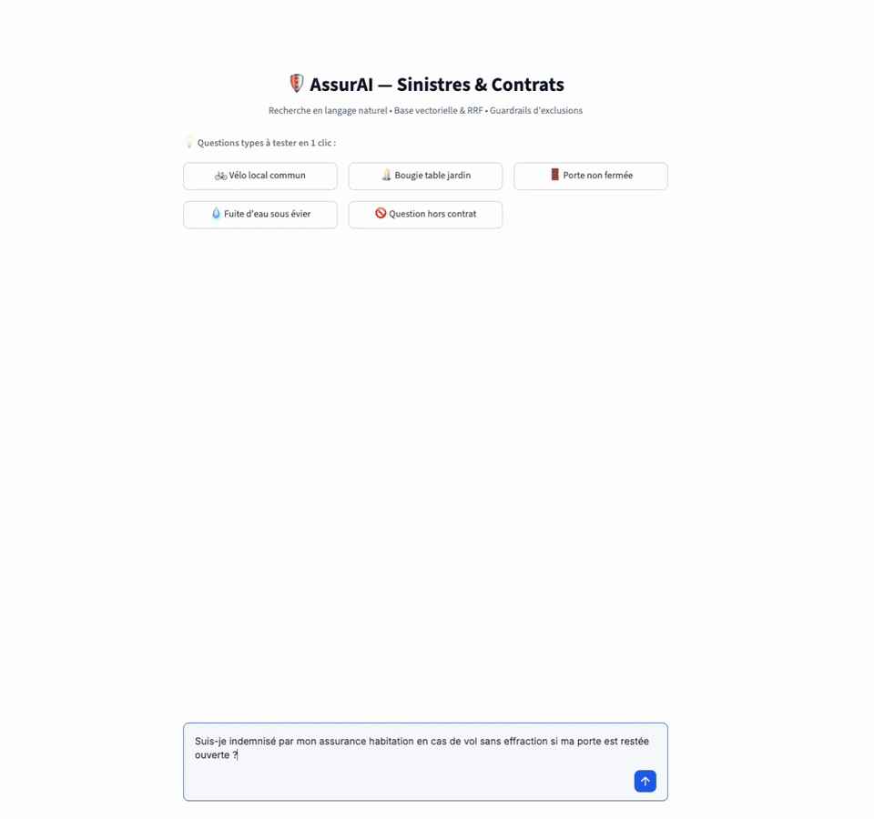
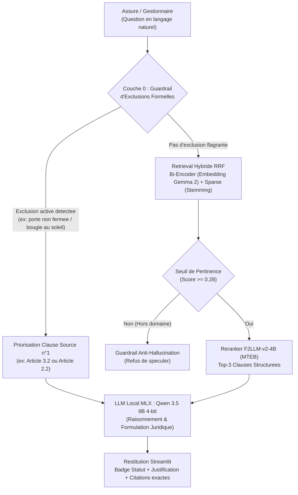
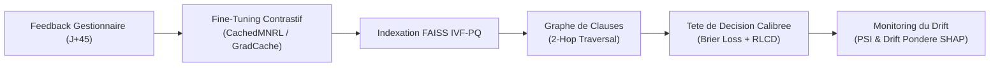

# AssurAI — Moteur Decisionnel de Sinistres et RAG Contractuel

> Assistant d'arbitrage de sinistres d'assurance habitation combinant guardrails d'exclusions deterministes, retrieval hybride (Dense + RRF) et generation locale sur Apple Silicon (MLX).

Depot officiel : [https://github.com/Zoko91/AssurAI](https://github.com/Zoko91/AssurAI)

---

## Demonstration de l'Interface

### Capture d'Ecran de Restitution
L'interface restitue la decision sous forme de badge colore explicite, accompagnee du raisonnement juridique synthetique, du tiroir des clauses sources citees in extenso et des metriques d'execution en temps reel :

<p align="center">
  
</p>

### Demonstration Video en Temps Reel
Exemple d'interaction complete montrant la saisie d'un cas de vol de velo dans un local commun non ferme a cle, l'interception par le guardrail et la generation du refus motive par le LLM local :

<p align="center">
  
</p>

*(Fichier video au format standard disponible dans [assets/demo.mp4](assets/demo.mp4)).*

---

## Problematique Metier : Pourquoi le RAG Naif Echoue en Assurance

Dans le secteur de l'assurance, le RAG naif (injection brute de PDF contractuels decoupes en blocs de 500 tokens) presente des failles critiques en conditions reelles :

1. **L'illusion de garantie (Sycophancy Bias) :** Face a une question comme *"Si la porte n'est pas fermee et qu'on s'introduit chez moi pour voler, suis-je couvert ?"*, la similarite vectorielle isole la clause generale de vol et le LLM hallucine un accord de prise en charge, en ignorant la condition suspensive de fermeture.
2. **L'incapacite a prouver une absence :** En droit de l'assurance, tout ce qui n'est pas expressement stipule ou qui viole une condition d'application est exclu. Le RAG standard ne sait pas modeliser le manquement d'une condition prealable.
3. **Le piege des exclusions croisees :** Les garanties et les clauses d'exclusions formelles se trouvent souvent disseminees dans des chapitres distincts d'un contrat de 60 pages.

AssurAI resout ce defi par une architecture en cascade : filtrage deterministe des exclusions (Couche 0), recherche dense et sparse avec Reciprocal Rank Fusion (RRF), et generation contrainte par LLM local quantifie.

---

## Architecture du Systeme



---

## Ce qui est Implemente dans ce Depot

Cette section decrit strictement les briques developpees et actives dans le code de ce repository :

### 1. Ingestion et Parsing Structure au Niveau Clause
- **Corpus contractuel :** Fichier brut de conditions generales habitation (`data/raw/conditions_generales_habitation.txt`) modelise d'apres les standards complets de l'assurance multirisque habitation (dispositions generales, vol, incendie, degats des eaux, responsabilite civile, tempete et grele, catastrophes naturelles, bris de glaces, dommages electriques, relogement, assistance d'urgence).
- **Parsing relationnel (`src/parser.py`) :** Rejet du chunking arbitraire par blocs de texte. Chaque article est decoupe en unite atomique selon le modele Pydantic strict `ContractClause` (`src/schemas.py`), extrayant la reference d'article, la garantie, les lieux d'application, les conditions suspensives et les exclusions formelles.
- **Enrichissement semantique avant embedding :** Chaque clause est projetee via un gabarit contextuel enrichi associant titre, garantie, conditions et exclusions au texte juridique.

### 2. Retrieval Hybride et Reranking Haute Precision (F2LLM)
- **Etape 1 - Retrieval Hybride (Dense + Sparse avec RRF) :**
  - **Recherche Dense :** [Embedding Gemma 2](https://huggingface.co/mlx-community/embeddinggemma-2-bf16) pour capter la proximite semantique globale.
  - **Recherche Sparse avec Stemming Francais :** Algorithme de reduction morphologique eliminant les mots vides et gerant les accords singulier/pluriel (*velo* / *velos*, *porte* / *portes*).
  - **Fusion RRF ($k=60$) :** Combinaison des rangs dense et sparse pour extraire un premier pool de **10 clauses candidates**.
- **Etape 2 - Reranking Haute Precision (F2LLM-v2-4B MLX 8-bit) :**
  - Modele issu du [Leaderboard MTEB Reranking](https://huggingface.co/spaces/mteb/leaderboard) execute nativement en 8-bit sous MLX.
  - Re-classement par attention croisee des 10 clauses candidates a l'aide d'un prompt d'instruction dedie, permettant d'isoler les nuances juridiques critiques (ex: distinction entre parties communes et logement privatif).
  - Selection du **Top 3** definitif transmis au modele de generation.

### 3. Couche 0 : Guardrail Deterministe d'Exclusion
- Un filtre logique intercepte les manquements formels avant generation libre du LLM (ex: absence de verrouillage, local collectif laisse ouvert, source de chaleur sans flammes vives).
- En cas d'activation, le statut est verrouille a `NON_COUVERT` et la clause correspondante (ex: Article 3.2 ou Article 3.3) est imposee en source prioritaire.
- Le LLM est contraint par le prompt de rediger une notification de refus structuree citant in extenso l'article active.

### 4. Stack de Modeles Locaux Utilisee
- **LLM :** [Qwen 3.5 9B MLX 4-bit](https://huggingface.co/mlx-community/Qwen3.5-9B-MLX-4bit) execute localement sur Apple Silicon avec environ 5 Go de memoire unifiee.
- **Bi-Encoder Dense :** [Embedding Gemma 2](https://huggingface.co/mlx-community/embeddinggemma-2-bf16) utilise pour la projection dense des requetes et des clauses.
- **Reranker :** [F2LLM-v2-4B-mlx-8bit](https://huggingface.co/fcmeyer/F2LLM-v2-4B-mlx-8bit) pour le re-classement haute precision par attention croisee.
- **Validation continue :** Suite de 15 tests unitaires automatiques sous `pytest` (`tests/`) validant l'integrite des donnees et les cas limites d'exclusions.

---

## Perspectives d'Amelioration pour le Passage a l'Echelle (At Scale)

Les approches suivantes n'ont pas ete integrees dans ce depot car elles constitueraient une sur-ingenierie sur un volume restreint de demonstration, mais representent l'architecture cible pour une plateforme industrielle traitant des millions de documents :



### 1. Indexation Vectorielle Approximative (FAISS IVF-PQ)
- Pour des catalogues de plusieurs millions de documents, l'indexation par matrice brute en memoire ne passe plus l'echelle.
- **IVF (Inverted File) :** Partitionnement de l'espace en clusters de Voronoi ($nlist$) pour limiter la recherche aux seuls $nprobe$ clusters les plus proches.
- **PQ (Product Quantization) :** Decoupage d'un vecteur de 1024 flottants (4096 octets) en $M=64$ sous-vecteurs quantifies sur 256 centroides (compression d'un facteur 64, ramenant le vecteur a 64 octets).
- **ADC (Asymmetric Distance Computation) :** Calcul par table de correspondance precalculee en memoire sans decompresser les vecteurs du corpus.

### 2. Modele Sparse Neuronal Appris (SPLADE / BGM)
- Remplacement du ranker lexical algorithmique par un modele sparse entraine de type **SPLADE** (*Sparse Lexical and Expansion Model*).
- Contrairement au simple comptage heuristique de racines lexicales (stemming), un modele sparse neuronal projette les declarations dans l'espace de vocabulaire avec des poids appris, realisant une expansion lexicale automatique pour capturer les synonymes et le jargon assurantiel implicite sans regles manuelles.

### 3. Fine-Tuning Contrastif (CachedMNRL / GradCache)
- Entrainement du bi-encodeur sur triplets `(Requete, Clause pertinente, Hard Negative)` via la fonction de perte Multiple Negatives Ranking Loss.
- Utilisation de GradCache pour simuler de grands batchs (16 000 paires) en memoire GPU sans saturation.
- *Raison de non-implementation sur le POC :* Risque eleve de surapprentissage et d'effondrement catastrophique de l'espace vectoriel (*catastrophic forgetting*) en l'absence d'une base massive de paires verifiees.

### 4. Graphe de Similarite et Resolution d'Entites (2-Hop Traversal)
- Construction d'un graphe de clauses pour relier les garanties par transitivite topologique et detecter les equivalences de clauses entre polices d'assurance distinctes.

### 5. Tete de Decision Calibree et Observabilite MLOps
- Remplacement de la generation libre par un classifieur optimise par **Perte de Brier** et **RLCD** (*Reinforcement Learning for Calibrated Decisions*) pour sanctionner les erreurs formulees avec un niveau de certitude eleve.
- **Surveillance de la derive (Drift) :** Calcul continu du **Population Stability Index (PSI)** et du test de **Kolmogorov-Smirnov**, avec ponderation des alertes par les valeurs d'attribution **TreeSHAP** pour ne surveiller que les variables influencant la prise de decision.

---

## Installation et Utilisation

### Prerequis
- Mac Apple Silicon (M1/M2/M3/M4) avec support MLX
- Python 3.11 ou superieur

### 1. Clonage du Depot
```bash
git clone https://github.com/Zoko91/AssurAI.git
cd AssurAI
```

### 2. Creation de l'Environnement Virtuel
```bash
python3 -m venv .venv
source .venv/bin/activate
pip install -r requirements.txt
```

### 3. Execution des Tests Unitaires
```bash
PYTHONPATH=. pytest tests/ -v
```
Les 15 tests automatises verifient la conformite du schema Pydantic, les cas tests officiels d'exclusions et la non-regression du pipeline RAG.

### 4. Lancement de l'Application
```bash
streamlit run app.py
```
L'interface s'ouvre localement sur `http://localhost:8501`.

---

## Structure du Repertoire

```
├── app.py                      # Application Streamlit (Chat temps reel, theme clair)
├── requirements.txt            # Dependances logicielles
├── README.md                   # Documentation technique et d'architecture
├── assets/                     # Medias de demonstration (GIF, MP4, PNG)
│   ├── screenshot.png          # Capture de l'interface
│   ├── demo.gif                # Demonstration animee
│   └── demo.mp4                # Video MP4 H.264
├── src/
│   ├── schemas.py              # Modeles stricts Pydantic v2
│   ├── parser.py               # Extraction relationnelle du contrat brut
│   ├── contract_store.py       # Requetage structure par metadonnees
│   ├── engine.py               # Moteur d'evaluation contradictoire
│   └── rag_pipeline.py         # Pipeline RAG (Embedding Gemma 2 + F2LLM Reranker + Qwen 3.5 MLX)
├── data/
│   ├── raw/                    # Corpus juridique brut de conditions generales
│   ├── processed/              # Base relationnelle structuree (clauses_db.json)
│   └── eval/                   # Golden benchmark d'evaluation (benchmark_sinistres.json)
├── tests/
│   ├── test_data_pipeline.py   # Tests d'integrite des donnees et parsing
│   ├── test_engine.py          # Tests du moteur de regles
│   └── test_rag_pipeline.py    # Tests du pipeline RAG et des guardrails
└── .streamlit/
    └── config.toml             # Configuration forcee du theme clair
```

---

## Avertissement et Cadre d'Utilisation

Ce projet est un prototype experimental developpe a titre strictement personnel et a petite echelle (*small-scale prototype*). Il a ete concu uniquement dans un but de demonstration technique et d'exploration algorithmique. Il ne constitue en aucun cas un produit commercial, un conseil juridique ou un service d'assurance en production, et ne doit etre utilise a aucune autre fin que la demonstration de faisabilite.
